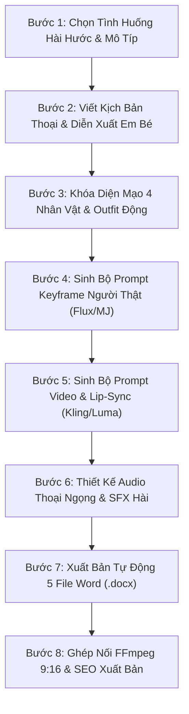

# HAN-DAILY-FAMILY-VLOG: HỆ THỐNG SẢN XUẤT VIDEO TIỂU PHẨM GIA ĐÌNH HÀI HƯỚC TRIỆU VIEW

Skill chuyên dụng cho kênh **Hân Daily** (`10. Han Daily`) và các dự án video ngắn gia đình, em bé hài hước, đời sống ấm áp trên YouTube Shorts, TikTok và Facebook Reels.

---

## 1. NGUYÊN TẮC CỐT LÕI (CORE DOCTRINES)

### 1. Hệ Thống 4 Nhân Vật Người Thật Độc Lập & Quy Tắc Zero-Default
Mỗi thành viên trong gia đình sở hữu một file ảnh Turnaround Model Sheet độc lập tại `assets/` và `D:\LAM YOUTUBE\1. Cac kenh youtube\10. Han Daily\3. Nhan vat\`:
- **Bé Hân (3 tuổi - Chị lớn):** `01_Be_Han_3Tuoi_Turnaround.jpg` (`@_Brand_Baby_Lead`)
- **Bé Bo (8 tháng - Em trai):** `02_Be_Bo_8Thang_Turnaround.jpg` (`@_Brand_Toddler_Boy`)
- **Mẹ Uyên Hân (25 tuổi):** `03_Me_Uyen_Han_Turnaround.jpg` (`@_Brand_Mother_Lead`)
- **Ba Hoàng Long (27 tuổi):** `04_Ba_Hoang_Long_Turnaround.jpg` (`@_Brand_Father_Lead`)
- **Quy tắc Zero-Default:** Ảnh mẫu chỉ dùng để khóa diện mạo và độ tuổi. Trang phục (đồ mặc nhà, váy yếm, bodysuit thú bông) và bối cảnh (phòng khách, phòng ngủ, nhà bếp, xe ô tô) hoàn toàn biến động linh hoạt theo từng tập (`[DYNAMIC_OUTFIT_STRING]`, `[DYNAMIC_SCENE_STRING]`).

### 2. Định Dạng Tiểu Phẩm Hài Hước (12s – 25s)
Mỗi video là một câu chuyện ngắn hoàn chỉnh có mở đầu, cao trào dỗi hờn/bất ngờ và kết thúc bật cười ấm áp của gia đình.

### 3. Tiêu Chuẩn Kết Xuất File Word (.docx)
Toàn bộ 5 file Word xuất bản trong thư mục `export_batch/` phải tuân thủ nghiêm ngặt: **100% Plain Text Paragraphs, KHÔNG CÓ BẤT KỲ TABLE NÀO**, định dạng khoảng cách đoạn 14pt giúp copy-paste 1 chạm sang AI tools.

---

## 2. QUY TRÌNH VẬN HÀNH 8 BƯỚC (8-STAGE SOP PIPELINE)

### Bước 1: Chọn Tình Huống Hài Hước & Mô Típ
- Chọn 1 trong 4 mô-típ: Trêu ăn uống, Tranh giành tình cảm ba mẹ, Bà cụ non nghe điện thoại/giảng đạo, Tình huống hài đời thường.

### Bước 2: Viết Kịch Bản Thoại & Diễn Xuất Em Bé
- Xây dựng 2–3 phân cảnh ngắn: Thiết lập tình huống (Situation) -> Phản ứng đứng hình / bĩu môi dỗi hờn (Reaction) -> Cái kết bật cười ấm áp (Ending).

### Bước 3: Khóa Diện Mạo 4 Nhân Vật & Outfit Động
- Ghép các Token nhận diện chuẩn từ [01-family-characters-sheet.md](file:///d:/LAM%20YOUTUBE/SKILL/XUANLV/.agents/skills/han-daily-family-vlog/references/01-family-characters-sheet.md).

### Bước 4: Sinh Bộ Prompt Keyframe Người Thật (Flux / MJ 9:16)
- Chuẩn tỷ lệ dọc `--ar 9:16 --style raw`, áp dụng công thức từ [04-mega-prompts-templates.md](file:///d:/LAM%20YOUTUBE/SKILL/XUANLV/.agents/skills/han-daily-family-vlog/references/04-mega-prompts-templates.md).

### Bước 5: Sinh Bộ Prompt Video & Lip-Sync
- Điều chỉnh Motion Level an toàn (0.35 - 0.45) để giữ trọn vẹn nét mặt và bàn tay em bé theo [05-video-motion-and-lipsync.md](file:///d:/LAM%20YOUTUBE/SKILL/XUANLV/.agents/skills/han-daily-family-vlog/references/05-video-motion-and-lipsync.md).

### Bước 6: Thiết Kế Audio Thoại Ngọng & SFX Hài
- Thiết kế voiceover giọng con nít ngọng nghịu, tiếng cười nắc nẻ và SFX hoạt hình theo [06-audio-voice-and-comedy-sfx.md](file:///d:/LAM%20YOUTUBE/SKILL/XUANLV/.agents/skills/han-daily-family-vlog/references/06-audio-voice-and-comedy-sfx.md).

### Bước 7: Xuất Bản Tự Động 5 File Word (.docx)
- Chạy script `scripts/export_batch_docx.py` để kết xuất 5 file Word chuẩn 100% Plain Text Paragraphs không Table.

### Bước 8: Ghép Nối FFmpeg 9:16 & SEO Xuất Bản
- Render bản video hoàn chỉnh qua dòng lệnh FFmpeg theo [07-assembly-ffmpeg.md](file:///d:/LAM%20YOUTUBE/SKILL/XUANLV/.agents/skills/han-daily-family-vlog/references/07-assembly-ffmpeg.md) và tối ưu SEO theo [09-publishing-and-seo.md](file:///d:/LAM%20YOUTUBE/SKILL/XUANLV/.agents/skills/han-daily-family-vlog/references/09-publishing-and-seo.md).

---

## 3. THƯ VIỆN TÀI LIỆU HỖ TRỢ (REFERENCES)
- [01-family-characters-sheet.md](file:///d:/LAM%20YOUTUBE/SKILL/XUANLV/.agents/skills/han-daily-family-vlog/references/01-family-characters-sheet.md): Hồ sơ 4 nhân vật gia đình người thật.
- [02-baby-expressions-and-skits.md](file:///d:/LAM%20YOUTUBE/SKILL/XUANLV/.agents/skills/han-daily-family-vlog/references/02-baby-expressions-and-skits.md): Từ điển biểu cảm má bánh bao, dỗi hờn, cười nắc nẻ.
- [03-home-and-family-scenes.md](file:///d:/LAM%20YOUTUBE/SKILL/XUANLV/.agents/skills/han-daily-family-vlog/references/03-home-and-family-scenes.md): Bối cảnh phòng khách, phòng ngủ, nhà bếp, xe hơi.
- [04-mega-prompts-templates.md](file:///d:/LAM%20YOUTUBE/SKILL/XUANLV/.agents/skills/han-daily-family-vlog/references/04-mega-prompts-templates.md): Khuôn mẫu prompt tạo ảnh & video gia đình.
- [05-video-motion-and-lipsync.md](file:///d:/LAM%20YOUTUBE/SKILL/XUANLV/.agents/skills/han-daily-family-vlog/references/05-video-motion-and-lipsync.md): Kiểm soát chuyển động và nhép môi em bé.
- [06-audio-voice-and-comedy-sfx.md](file:///d:/LAM%20YOUTUBE/SKILL/XUANLV/.agents/skills/han-daily-family-vlog/references/06-audio-voice-and-comedy-sfx.md): Lồng tiếng con nít & hiệu ứng âm thanh hài hước.
- [07-assembly-ffmpeg.md](file:///d:/LAM%20YOUTUBE/SKILL/XUANLV/.agents/skills/han-daily-family-vlog/references/07-assembly-ffmpeg.md): Dòng lệnh render FFmpeg 9:16 tự động.
- [08-lessons-learned.md](file:///d:/LAM%20YOUTUBE/SKILL/XUANLV/.agents/skills/han-daily-family-vlog/references/08-lessons-learned.md): Xử lý các lỗi AI tạo trẻ em.
- [09-publishing-and-seo.md](file:///d:/LAM%20YOUTUBE/SKILL/XUANLV/.agents/skills/han-daily-family-vlog/references/09-publishing-and-seo.md): Tiêu đề giật tít, hashtag viral & thumbnail.
