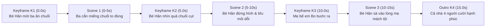

# FLOW: Tiến Trình Keyframe & Chuyển Giao Trạng Thái

## 1. Sơ Đồ Tiến Trình Chuyển Động (Workflow Diagram)

---

## 2. Chuỗi Keyframe Định Vị ($K_1 \to K_2 \to K_3 \to K_4$)

- **Keyframe K1 (0.0s):**
  - Bé Hân cười hớn hở đưa quả chuối vàng cho ba, ba Hoàng Long chuẩn bị há miệng cắn.
- **Keyframe K2 (5.0s - Điểm nối Cảnh 1 sang Cảnh 2):**
  - Quả chuối mất 1/2 miếng to, bé Hân chớp mắt ngỡ ngàng, má phồng nhẹ.
- **Keyframe K3 (10.0s - Điểm nối Cảnh 2 sang Cảnh 3):**
  - Bé Hân quay người nhìn về phía cửa bếp, mẹ bế em Bo mỉm cười đi ra.
- **Keyframe K4 (15.0s):**
  - Bé Hân ôm eo mẹ, em Bo vỗ tay, ba gãi đầu cười hối lỗi, cả nhà tràn ngập niềm vui.

---

## 3. Quy Tắc Giữ Trục Thị Giác
1. **Khóa trang phục 4 nhân vật:** Váy yếm be của bé Hân, áo len rêu của ba, áo đỏ burgundy của mẹ và bodysuit gấu của em Bo giữ nguyên thiết kế 100%.
2. **Khóa phụ kiện:** Túi hạt ngọc trai mini và kẹp hoa cúc của bé Hân, kính ngố tròn của ba không bị biến mất hay đổi kiểu.
3. **Ánh sáng phòng khách:** Ánh sáng tự nhiên ấm áp xuyên qua rèm voan giữ đồng nhất xuyên suốt 3 cảnh.
