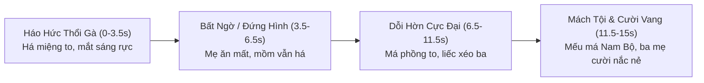

# DÒNG CHẢY CẢM XÚC & THIẾT KẾ CÚ MÁY (FLOW & CAMERA DIRECTION)
## Tập: Cú Lừa Gà Rán & Pha Liếc Xéo Huyền Thoại (15.0s)

---

### 1. SƠ ĐỒ DÒNG CHẢY CẢM XÚC (EMOTIONAL ARC)

---

### 2. KỸ THUẬT QUAY CỐ ĐỊNH DUY NHẤT (SINGLE MASTER TAKE)

- **Góc máy:** Cố định ngang tầm ngực em bé (Locked-off Eye-level Toddler Triad Shot), đặt trên tripod cách bàn ăn 1.5 mét, góc quay 9:16 dọc hoàn hảo.
- **Bố cục khung hình (Framing):**
  - Mẹ Uyên Hân ngồi bên trái khung hình (profile 3/4 nhìn sang phải).
  - Bé Hân ngồi chính diện ở giữa (chủ thể tâm điểm).
  - Ba Hoàng Long ngồi bên phải khung hình (profile 3/4 nhìn sang trái).
  - Đĩa gà rán và nĩa ăn nằm ở tiền cảnh dưới bàn.
- **Lý do không cắt cảnh:** Khán giả YouTube Shorts / TikTok bật cười là vì nhìn thấy **toàn bộ quá trình biến đổi cơ mặt** của bé Hân từ ngây thơ sang phẫn nộ hài hước mà không có bất kỳ cú cắt máy nào phá vỡ nhịp tự nhiên.
